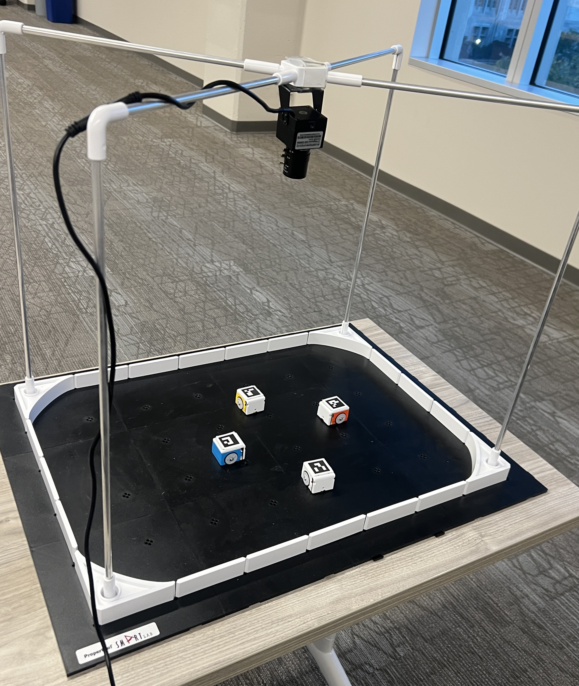
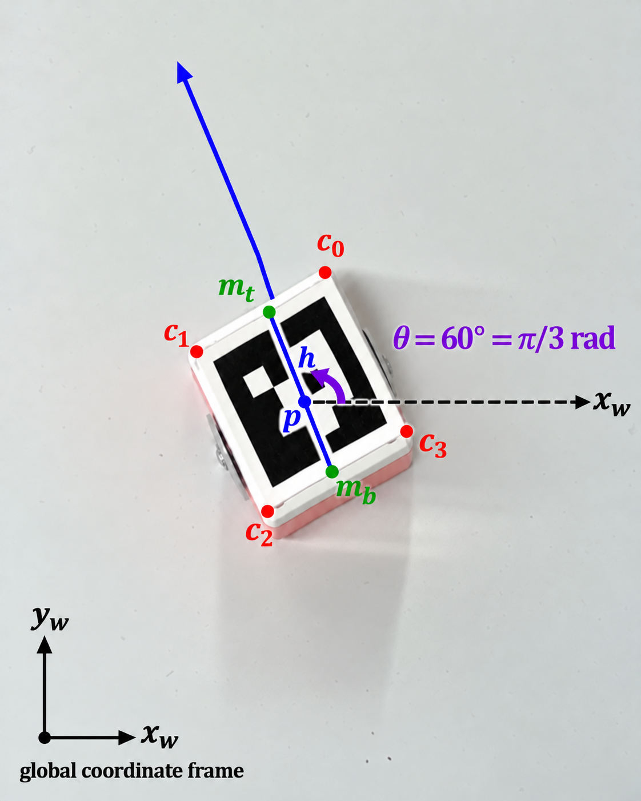
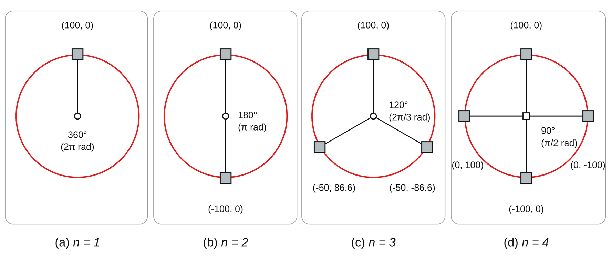
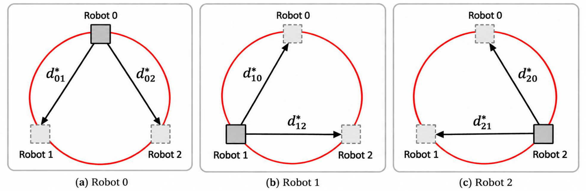
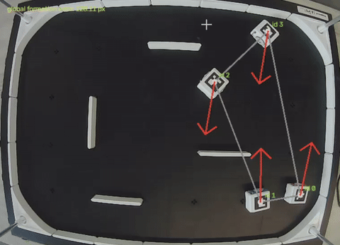
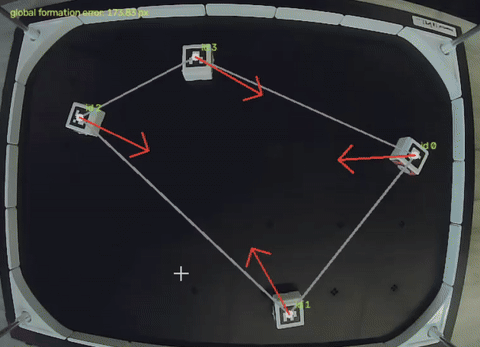

# Multi-Robot Formation Control with Differential-Drive Robots

This tutorial demonstrates formation control using HamsterS differential-drive robots and explains underlying concepts of multi-robot coordination.

In formation control, a team of robots works to achieve and maintain a desired spatial arrangement. In this implementation, the controller uses the robots' measured positions and desired relative displacements to determine how each robot should move. An overhead camera detects ArUco markers to estimate each robot's position and orientation, while a Python program converts the resulting control vectors into wheel commands. Although this tutorial uses HamsterS robots, the implementation can be adapted to other differential-drive robots.

## 1. Objectives

By the end of the tutorial, you should understand how to:

1. Detect and identify multiple robots using ArUco markers.
2. Estimate each robot's position and orientation from camera images.
3. Define a circular formation using relative displacement vectors.
4. Calculate formation errors and control vectors for each robot.
5. Convert control vectors into differential-drive wheel commands.
6. Integrate perception and control in a continuous control loop.

Each robot is assigned a fixed slot in the desired circular formation. The objective is to establish this arrangement, not to bring all the robots to a single point.

## 2. System Overview

A stationary USB camera is mounted above the operating area, with a unique ArUco marker attached to each robot. OpenCV detects these markers and estimates each robot's position and heading in image coordinates.

The Python program compares the robots' measured pairwise displacements with those of the desired circular formation. It then computes a two-dimensional control vector for each robot and sends wheel commands through RoboID. The system is centralized: one computer processes the camera images and controls all the robots. If a required marker is missing from a frame, all robots stop until valid observations are restored. Onboard proximity sensors provide basic reactive obstacle avoidance.

### Project Structure

```text
project/
├── images/
├── utils/
│   ├── camera_supervisor.py
│   ├── formation_control.py
│   ├── actuation.py
│   └── img_overlay.py
├── README.md
├── TUTORIAL.md
├── main.py
└── settings.py
```

- `images/`: Contains the figures and demonstrations used in the tutorial.
- `utils/`: Contains supporting modules for perception, formation control, actuation, and visualization.
- `README.md`: Provides an overview of the project.
- `TUTORIAL.md`: Contains these step-by-step tutorial instructions.
- `main.py`: Initializes robots and runs the control loop.
- `settings.py`: Stores robot IDs, formation parameters, controller gains, and thresholds.
- `utils/camera_supervisor.py`: Detects ArUco markers and estimates robot poses.
- `utils/formation_control.py`: Generates the desired formation and relative displacements.
- `utils/actuation.py`: Converts control vectors into wheel commands.
- `utils/img_overlay.py`: Optionally visualizes robot positions, control vectors, and formation error.

## 3. Hardware

### Requirements

- Robots: Two or more HamsterS robots (or equivalent differential-drive robots).
- Camera: One overhead USB camera, preferably capable of capturing 1080p video.
- ArUco markers: One printed ArUco marker per robot.
- Computer: A computer capable of running Python.

**Note:** The formation equations and pose-estimation approach are not specific to HamsterS. Other robot platforms may require adapting the implementation to use their respective software development kits (SDKs) instead of RoboID.

### Generating Markers

The following example generates marker ID 0 from the `DICT_7X7_100` ArUco dictionary. This matches the first ID in the example configuration:

```python
import cv2
dictionary = cv2.aruco.getPredefinedDictionary(
   cv2.aruco.DICT_7X7_100
)
marker = cv2.aruco.generateImageMarker(
   dictionary,
   0,  # Marker ID
   500,  # Image size in pixels
)
cv2.imwrite("marker_0.png", marker)
```

Generate a different marker ID for each robot, and use the same dictionary for detection. Print each marker flat with a clear white margin, and attach it securely so that it cannot rotate relative to the robot.

**Orientation convention:** Mount each marker so that its top edge points toward the front of the robot. The heading calculations below assume this orientation.

### Camera Placement

Secure the camera above the operating area, with its view approximately perpendicular to the floor. Keep all markers within view and provide consistent lighting. Changes in autofocus and motion blur can make markers harder to detect; a fixed-focus setting can help.

<p align="center">
  
</p>
<p align="center"><em>Figure 1. Experimental setup with an overhead camera and four HamsterS robots.</em></p>

## 4. Software Requirements

The implementation uses:

- Python 3.10 or newer (the `RobotAgent` type hints use `| None`).
- NumPy for array and vector calculations.
- OpenCV with ArUco support for image capture and marker detection.
- RoboID for HamsterS communication and wheel commands.

Install the Python dependencies:

```bash
python -m pip install numpy opencv-contrib-python roboid
```

The example controller imports RoboID using:

```python
from roboid import *
```

For other robot platforms, use the manufacturer's Python SDK or control API.

### Controller Settings

The relevant values in `settings.py` are:

```python
target_ids = [0, 1, 2, 3]
ROBOTS_N = 4
SHAPE_R = 100
KP_DISTANCE = 0.7
KP_ANGLE = 0.5
DISTANCE_THRESHOLD = 10  # Control-vector magnitude, pixels
ANGLE_THRESHOLD = 30    # Degrees
OBS_THRESHOLD = 70
OBS_SPEED = 50
```

The order in `target_ids` defines the mapping between detected markers and robot connections: marker ID 0 corresponds to robot index 0, ID 1 to index 1, ID 2 to index 2, and ID 3 to index 3 in this example. Marker IDs do not have to match robot indices, as long as the mapping remains consistent. Connect the physical robots in that order. An ArUco marker ID is not a RoboID connection ID. During initialization, `slot=i` also assigns robot index `i` to formation slot `i`.

`SHAPE_R` is measured in image pixels. The controller gains and thresholds are explained in [Section 7: Converting a Vector into Robot Motion](#7-converting-a-vector-into-robot-motion).

## 5. Tracking Robot Poses

### ArUco Marker Detection

Create a detector using the same dictionary used to print the markers:

```python
import cv2
aruco_dict = cv2.aruco.getPredefinedDictionary(cv2.aruco.DICT_7X7_100)
detector = cv2.aruco.ArucoDetector(aruco_dict)
```

For each camera frame:

```python
corners, ids, rejected = detector.detectMarkers(frame)
```

`detectMarkers()` returns:

- `corners`: One array of four corner coordinates for each successfully identified marker.
- `ids`: Corresponding marker IDs, or `None` if no markers were identified.
- `rejected`: Candidate marker regions that could not be identified. These are not used here; `rejected` is not a Boolean.

OpenCV returns each marker's corners in the order top-left, top-right, bottom-right, and bottom-left, relative to the marker's encoded orientation. Each `corners[k]` corresponds to `ids[k]`.

```python
if ids is not None:
    for marker_corner, marker_id in zip(corners, ids.flatten()):
        marker_corner = marker_corner.reshape((4, 2))
        print(f"Detected marker ID: {int(marker_id)}")
```

To optionally display detected marker outlines and IDs on the camera image, add the following after `detectMarkers()`:

```python
if ids is not None:
    cv2.aruco.drawDetectedMarkers(frame, corners, ids)
```

### Finding Robot Position

A robot's position is estimated from the center of its ArUco marker, found by averaging the coordinates of its four corners.

For marker corners $`c_0,c_1,c_2,c_3`$, the center is:

```math
p_i=\begin{bmatrix}x_i\\y_i\end{bmatrix}=\frac{c_0+c_1+c_2+c_3}{4}
```

Here:

- $`p_i=[x_i,y_i]^T`$: Estimated position of robot $`i`$ in image coordinates.
- $`c_0,c_1,c_2,c_3`$: The four detected ArUco marker corners, each represented as an $`(x,y)`$ coordinate.
- $`i`$: Index identifying a robot.

Example:

```python
marker_corners = corners[index][0]
center = marker_corners.mean(axis=0)
x = center[0]
y = center[1]
```

Robot positions are expressed directly in camera pixel coordinates. The image origin is at the top-left corner; x increases to the right and y increases downward. The marker center approximates the robot's center only if the marker is mounted centrally.

### Finding Robot Orientation

The robot's heading is estimated from the direction pointing from the marker's bottom edge toward its top edge.

<p align="center">
  
</p>
<p align="center"><em>Figure 2. ArUco marker heading direction and orientation angle.</em></p>

OpenCV uses zero-based corner indices $`c_0`$ through $`c_3`$. The controller computes angles in image coordinates, where the positive y-direction points downward.

First, calculate the midpoints of the top and bottom edges:

```math
m_{\mathrm{top}}=\frac{c_0+c_1}{2},\qquad m_{\mathrm{bottom}}=\frac{c_2+c_3}{2}
```

```python
top_center = (topLeft + topRight) / 2
bottom_center = (bottomLeft + bottomRight) / 2
```

Next, subtract the bottom-edge midpoint from the top-edge midpoint to obtain the heading vector:

```math
h_i=m_{\mathrm{top}}-m_{\mathrm{bottom}}
```

```python
heading_vector = top_center - bottom_center
```

Calculate the robot's orientation from this heading vector:

```math
\theta_i=\operatorname{atan2}(h_{iy},h_{ix})
```

```python
theta = math.degrees(
   math.atan2(
       heading_vector[1],
       heading_vector[0]
   )
)
```

The heading is measured in degrees. Normalize it to the range $`[0^\circ,360^\circ)`$:

```python
theta %= 360
```

The robot's pose can be written as $`[x,y,\theta]`$, where $`\theta`$ is its heading relative to the positive image x-axis. Because image y-coordinates increase downward, positive angles rotate clockwise. The `RobotAgent` class stores `position` and `orientation` in separate fields.

### Updating Poses Safely

The `update_poses()` function in `utils/camera_supervisor.py` updates each robot's position and orientation from the current frame.

Reset every pose before processing each new frame. Otherwise, a robot that disappears from view could retain its previous position and orientation. The function can be written as follows:

```python
def update_poses(ROBOTS, frame):
    for robot in ROBOTS.values():
        robot.position = None
        robot.orientation = None
    corners, ids, _ = detector.detectMarkers(frame)
    if ids is None:
        return
    for marker_corner, marker_id in zip(corners, ids.flatten()):
        marker_id = int(marker_id)
        if marker_id not in ROBOTS:
            continue
        c = marker_corner.reshape((4, 2))
        topLeft, topRight, bottomRight, bottomLeft = c
        heading = ((topLeft + topRight) - (bottomLeft + bottomRight)) / 2
        ROBOTS[marker_id].position = c.mean(axis=0)
        ROBOTS[marker_id].orientation = (
            math.degrees(math.atan2(heading[1], heading[0])) % 360
        )
```

This function requires `import math` and an initialized ArUco `detector` in `camera_supervisor.py`. Any robot not detected in the current frame retains a `None` pose, allowing the main control loop to stop the robots instead of acting on outdated measurements.

## 6. Formation Control

Unlike rendezvous, where robots converge to a common point, formation control aims to achieve a specified spatial arrangement. The controller compares the measured displacement between each pair of robots with the corresponding displacement in the desired formation.

### Circular Formation

In a circular formation, the robots occupy equally spaced positions around a circle. We call the set of desired positions $`P^*`$ ("P star"). Dividing a full revolution, $`2\pi`$ radians ($`360^\circ`$), by the number of robots gives the angular spacing between slots. Each robot is assigned a fixed slot, whose angle determines its desired coordinates:

```math
p_i^* = \begin{bmatrix}
R\cos\left(\frac{2\pi i}{N}\right) \\
R\sin\left(\frac{2\pi i}{N}\right)
\end{bmatrix}, \qquad i=0,\ldots,N-1
```

Here:

- $`P^*`$: The array containing all desired formation positions $`p_i^*`$.
- $`N`$ (`ROBOTS_N`): Number of robots.
- $`R`$ (`SHAPE_R`): Desired formation radius, in image pixels.
- $`i`$: Index of a robot's fixed formation slot, starting at 0.
- $`2\pi/N`$: Angular spacing between consecutive slots.

<p align="center"></p>
<p align="center"><em>Figure 3. Desired circular formations for different numbers of robots (R = 100 pixels).</em></p>

With four robots, these positions form a square that appears diamond-shaped relative to the image axes. The $`N=1`$ case in Figure 3 illustrates slot geometry only; the multi-robot implementation uses two or more robots. The coordinates in $`P^*`$ are defined relative to the origin, $`(0,0)`$, and specify the formation's shape rather than a fixed location in the camera image. To achieve the same arrangement anywhere in the camera view, the controller uses relative displacements between formation slots.

```python
def p_star():
    desired_positions = np.zeros((settings.ROBOTS_N, 2))
    for k in range(settings.ROBOTS_N):
        th = 2 * np.pi * k / settings.ROBOTS_N
        desired_positions[k] = [
            settings.SHAPE_R * np.cos(th),
            settings.SHAPE_R * np.sin(th),
        ]
    return desired_positions
```

The center-to-center spacing between adjacent formation slots is:

```math
d_{\mathrm{adjacent}}=2R\sin\left(\frac{\pi}{N}\right)
```

For `ROBOTS_N = 4` and `SHAPE_R = 100`, adjacent slots are approximately 141.4 pixels apart. As the number of robots increases while the radius stays fixed, neighboring slots become closer together. Choose a radius that provides enough clearance between robots.

### Desired Pairwise Displacements

The set of desired pairwise displacement vectors is called $`D^*`$ ("D star"). Each vector describes how one robot should be positioned relative to another, independently of the formation's location in the image. These vectors are calculated from the desired positions in $`P^*`$:

```math
d_{ij}^* = p_j^* - p_i^*
```

Here:

- $`d_{ij}^*`$: Desired displacement vector pointing from robot $`i`$ to robot $`j`$.
- $`p_i^*`$ and $`p_j^*`$: Desired positions of the fixed formation slots for robots $`i`$ and $`j`$.
- `d_star(ROBOTS, desired_positions)`: Builds the desired-displacement array using each robot's assigned `slot`.

Subtracting $`p_i^*`$ from $`p_j^*`$ gives the vector from robot $`i`$'s desired slot to robot $`j`$'s desired slot. This vector specifies both the direction and distance between them. For example, if robot $`j`$ should be 100 pixels to the right of robot $`i`$, then $`d_{ij}^*=(100,0)`$. The same displacement applies wherever the formation is located in the camera view.

Figure 4 shows the desired displacement vectors from each robot's assigned slot to the other two slots in a three-robot formation. Solid squares identify the robot whose vectors are shown; dashed squares mark the other desired slots.

<p align="center"></p>
<p align="center"><em>Figure 4. Desired pairwise displacement vectors for robots 0, 1, and 2 in a three-robot circular formation.</em></p>

```python
def d_star(ROBOTS, desired_positions):
    desired_offset = np.zeros((settings.ROBOTS_N, settings.ROBOTS_N, 2))
    for robot_a in ROBOTS.values():
        for robot_b in ROBOTS.values():
            desired_offset[robot_a.robot_i, robot_b.robot_i] = (
                desired_positions[robot_b.slot]
                - desired_positions[robot_a.slot]
            )
    return desired_offset
```

Make sure `formation_control.py` contains both `p_star()` and `d_star()`, since `main.py` imports both functions.

### Formation Error and Control Vector

For each pair of robots, subtract the position of robot $`i`$ from the position of robot $`j`$ to obtain their current displacement. Subtracting the desired displacement $`d_{ij}^*`$ then gives the pairwise displacement error. The vector $`p_j-p_i`$ points from robot $`i`$ to robot $`j`$.

```math
d_{ij}=p_j-p_i
```

```math
e_{ij}=d_{ij}-d_{ij}^*=(p_j-p_i)-d_{ij}^*
```

For example, suppose $`p_i=(100,100)`$, $`p_j=(70,160)`$, and $`d_{ij}^*=(-100,100)`$:

```math
d_{ij}=(-30,60),\qquad e_{ij}=(-30,60)-(-100,100)=(70,-40)
```


Each robot sums its pairwise displacement errors to obtain a two-dimensional control vector $`u_i=[u_{ix},u_{iy}]`$:

```math
u_i=\sum_{\substack{j=0\\j\ne i}}^{N-1}e_{ij}
=\sum_{\substack{j=0\\j\ne i}}^{N-1}\big[(p_j-p_i)-d_{ij}^*\big]
```

For a given robot $`i`$, the sum runs from $`j=0`$ to $`N-1`$, excluding $`j=i`$. The control vector provides a desired movement direction and a magnitude used by the wheel-command routine. The implementation computes all pairwise displacements using NumPy broadcasting and sums them with `np.sum(displacement_error, axis=1)`. This includes the self-pair term $`e_{ii}=0`$, which does not affect the result. The control vector sums **displacement errors**, not uncorrected robot-to-robot distances.

## 7. Converting a Vector into Robot Motion

The formation controller produces a control vector $`u_i=[u_{ix},u_{iy}]`$ in the camera image coordinate frame. This vector specifies a desired direction of motion, but a differential-drive robot cannot move sideways. Instead, it changes its heading and moves forward by controlling the two wheel speeds. Here, the robot first turns toward its control vector and then drives forward.

### Target Heading

Calculate the direction of robot $`i`$'s control vector using:

```math
\theta_{\mathrm{target}}=\operatorname{atan2}(u_{iy},u_{ix})
```

The implementation converts this angle to degrees:

```python
target_angle = math.degrees(math.atan2(uy, ux))
```

This gives the desired heading in degrees, using the same image-coordinate convention as the robot's measured orientation. Subtract the current heading to calculate the angular error:

```python
angle_error = target_angle - theta
```

Wrap the angular error to the range $`[-180^\circ,180^\circ)`$ so that the robot turns in the direction requiring the least rotation:

```python
angle_error = (angle_error + 180) % 360 - 180
```

```math
e_\theta = ((\theta_{\mathrm{target}}-\theta_i+180)\bmod 360)-180
```

### Turning

When the absolute heading error exceeds `ANGLE_THRESHOLD`, the robot turns in place by rotating its wheels in opposite directions. The sign of the error determines which way it turns. The turn speed is proportional to the magnitude of the error, with a maximum command of 40:

```math
s_{\mathrm{turn}}=\min(K_{p,\theta}|e_\theta|,40)
```

```python
turn_speed = min(settings.KP_ANGLE * abs(angle_error), 40)
if angle_error > 0:
    robot.hamster.wheels(turn_speed, -turn_speed)
else:
    robot.hamster.wheels(-turn_speed, turn_speed)
```

### Forward Motion

Once the robot is facing approximately along its control vector, both wheels drive forward at the same speed. This moves the robot in the desired image direction. The gain $`K_{p,d}`$ corresponds to `KP_DISTANCE`, and $`K_{p,\theta}`$ in the turning equation corresponds to `KP_ANGLE`.

Calculate the magnitude (length) of the control vector using:

```math
\lVert u_i\rVert=\sqrt{u_{ix}^2+u_{iy}^2}
```

`DISTANCE_THRESHOLD` specifies how small $`\lVert u_i\rVert`$ must be before the formation-motion branch stops the robot. It is not a robot-to-robot distance threshold and does not guarantee that every pairwise error is below that value. The proximity response takes priority over normal formation motion.

The forward wheel speed is proportional to the control-vector magnitude, with a maximum command of 40:

```math
s_{\mathrm{forward}}=\min(K_{p,d}\lVert u_i\rVert,40)
```

```python
distance = np.linalg.norm(u)
if distance <= settings.DISTANCE_THRESHOLD:
    robot.hamster.wheels(0, 0)
elif abs(angle_error) <= settings.ANGLE_THRESHOLD:
    forward_speed = min(settings.KP_DISTANCE * distance, 40)
    robot.hamster.wheels(forward_speed, forward_speed)
```

The controller repeats the following steps:

- Calculate the direction of the control vector.
- Turn the robot toward that direction when the heading error exceeds the angle threshold.
- Drive forward once the robot is sufficiently aligned.
- Repeat until the control-vector magnitude falls below the stopping threshold.

### Reactive Obstacle Avoidance

Before issuing a formation-control command, `apply_control()` checks the HamsterS left and right proximity sensors. If either reading exceeds `OBS_THRESHOLD`, reactive obstacle avoidance takes priority for that iteration:

```python
left = robot.hamster.left_proximity()
right = robot.hamster.right_proximity()
if left > settings.OBS_THRESHOLD and right > settings.OBS_THRESHOLD:
    robot.hamster.wheels(-settings.OBS_SPEED, -settings.OBS_SPEED // 2)
    return
if left > settings.OBS_THRESHOLD:
    robot.hamster.wheels(settings.OBS_SPEED, -settings.OBS_SPEED)
    return
if right > settings.OBS_THRESHOLD:
    robot.hamster.wheels(-settings.OBS_SPEED, settings.OBS_SPEED)
    return
```

This is basic reactive obstacle avoidance, not collision-free path planning. It temporarily overrides formation motion; once the proximity readings no longer exceed the threshold, normal formation motion resumes. The missing-marker stop is handled separately by the main control loop. On another differential-drive platform, the same formation calculations can be used, but the sensor and wheel commands must be adapted.

<p align="center">
  
</p>
<p align="center"><em>Figure 5. Physical demonstration of reactive obstacle avoidance during formation control.</em></p>

### Tuning the Controller

Normal turning and forward wheel commands are capped at 40, independently of `OBS_SPEED`. `SHAPE_R` determines the formation radius, while `DISTANCE_THRESHOLD` applies to $`\lVert u_i\rVert`$ rather than individual robot-to-robot distances.

A smaller `ANGLE_THRESHOLD` requires closer heading alignment with the control vector. Setting it too low may cause repeated turning corrections because camera noise makes precise alignment difficult.

Begin with conservative wheel speeds. Higher speeds can cause overshooting, collisions, or wheel slippage. Near the formation, reducing wheel speed or increasing the stopping threshold can reduce oscillations. Under normal formation control, wheel speeds vary with angular error or control-vector magnitude rather than remaining constant.

## 8. Main Control Loop

The complete system repeatedly tracks the robots and updates their wheel commands. Each `RobotAgent` stores a robot's marker ID, robot index, HamsterS connection, assigned formation slot, position, and orientation. The following code blocks are consecutive parts of `main.py` and should be assembled in the order shown.

### Robot Initialization

```python
import cv2
from dataclasses import dataclass
import numpy as np
from roboid import *
from utils.camera_supervisor import update_poses
from utils.formation_control import p_star, d_star
from utils.actuation import apply_control
import settings

@dataclass
class RobotAgent:
    marker_id: int
    robot_i: int
    hamster: HamsterS
    slot: int
    position: np.ndarray | None = None
    orientation: float | None = None
```

At startup, `position` and `orientation` are `None` until the camera successfully detects the robot.

```python
ROBOTS = {
    marker_id: RobotAgent(
        marker_id=marker_id,
        robot_i=i,
        hamster=HamsterS(i),
        slot=i,
    )
    for i, marker_id in enumerate(settings.target_ids)
}
```

The robots are stored in a dictionary keyed by ArUco marker ID. `robot_i` indexes the position and control-vector arrays, while `slot=i` assigns each robot a fixed formation slot.

### Camera Capture and Pose Updates

Open the camera and request 30 frames per second (FPS). The actual frame rate depends on the camera and computer.

```python
cap = cv2.VideoCapture(0)
cap.set(cv2.CAP_PROP_FPS, 30)
```

Read camera frames continuously. The variable `ret` indicates whether a frame was captured successfully: `True` for success and `False` for failure.

```python
try:
    while True:
        ret, frame = cap.read()
        if not ret:
            print("Failed to grab frame")
            break
        update_poses(ROBOTS, frame)
```

`update_poses()` uses the marker-detection and pose-estimation methods described above to update each robot's `position` and `orientation` fields.

```python
        if any(robot.position is None for robot in ROBOTS.values()):
            for robot in ROBOTS.values():
                robot.hamster.wheels(0, 0)
            cv2.imshow("Camera", frame)
            if cv2.waitKey(1) & 0xFF == ord("q"):
                break
            continue
```

This check stops all robots if any required marker is missing from the current frame. It relies on `update_poses()` resetting missing poses to `None`.

### Formation Errors and Wheel Commands

```python
        positions = np.zeros((settings.ROBOTS_N, 2))
        for robot in ROBOTS.values():
            positions[robot.robot_i] = robot.position
        desired_positions = p_star()
        desired_offset = d_star(ROBOTS, desired_positions)
        # NumPy broadcasting produces all pairwise displacement vectors
        actual_offset = positions[None, :, :] - positions[:, None, :]
        displacement_error = actual_offset - desired_offset
```

The measured positions are used to calculate the displacement between every ordered pair of robots. `actual_offset[i, j]` equals $`p_j-p_i`$. Subtracting the desired offset gives the pairwise displacement error. Both displacement arrays have shape `(N, N, 2)`.

Summing each robot's pairwise displacement errors produces its control vector, as defined in Section 6. The resulting array has shape `(N, 2)`, with one two-dimensional vector per robot.

The `apply_control()` function in `utils/actuation.py` converts these vectors into wheel commands.

```python
        u = np.sum(displacement_error, axis=1)
        for robot in ROBOTS.values():
            apply_control(
                robot,
                u[robot.robot_i],
                robot.orientation,
            )
```

### Display and Cleanup

Display each camera frame after processing. Press `q` in the OpenCV window to end the loop. Marker outlines, IDs, and other overlays appear only if the optional drawing functions are enabled.

```python
        cv2.imshow("Camera", frame)
        if cv2.waitKey(1) & 0xFF == ord("q"):
            break
finally:
    for robot in ROBOTS.values():
        robot.hamster.wheels(0, 0)
    cap.release()
    cv2.destroyAllWindows()
```

## 9. Running the Tutorial

### Step 1: Prepare the robots

Attach a unique ArUco marker to each robot. Turn on the HamsterS robots and connect them to the computer in the order specified by `target_ids`. Place every robot within the camera's field of view.

### Step 2: Position the camera

Mount the camera above the operating area using an overhead mount or another stable support. Keep it stationary throughout the run.

Make sure:

- Every robot is visible
- The markers are facing the camera
- The image is in focus
- The lighting is consistent and adequate
- The camera remains stationary during operation

Before enabling formation control, confirm that each detected marker ID matches its robot, each measured heading points toward the robot's front, and a short turn command rotates the robot in the intended direction.

### Step 3: Start the program

Run:

```bash
python main.py
```

The camera window should show a live image. Marker outlines and IDs appear only when the optional drawing code is enabled; formation overlays from `img_overlay.py` are also optional.

Once the required markers are detected, the robots should turn toward their control vectors and move to reduce their formation errors.

### Step 4: Stop the system

Press `q` in the OpenCV camera window to end the program. The cleanup code stops every robot before closing.

## 10. Expected Result

Initially, the robots may be scattered across the operating area and facing different directions.

After starting the controller:

- The overhead camera detects the robot positions and orientations.
- The controller calculates each robot's errors relative to the desired circular formation.
- Each robot turns toward its control vector.
- The robots drive to reduce their pairwise displacement errors.
- The robots stop when their control-vector magnitudes are within the threshold, unless a proximity-avoidance command takes precedence.

The robots should not converge to a single point. With four robots, the target formation is a square centered around a common formation center. The final arrangement may differ slightly from the ideal formation because:

- The robots have physical size
- The camera measurements contain noise
- Wheel speeds may differ
- The stopping threshold limits repeated small corrections

### Real-Robot Demonstration

<p align="center">
  
</p>
<p align="center"><em>Figure 6. Physical demonstration of the robots moving into their desired formation.</em></p>

### Measuring Formation Error

Mean pairwise formation error measures how closely the measured robot arrangement matches the desired relative displacements:

```math
E(t)=\frac{1}{N(N-1)}\sum_{\substack{i,j=0 \\ i\ne j}}^{N-1}\lVert e_{ij}(t)\rVert
```

There are $`N(N-1)`$ ordered pairs of distinct robots. The metric averages the magnitudes of their displacement errors, so smaller values indicate a closer match to the desired formation. The `global_error()` function in `utils/img_overlay.py` calculates this metric, and `draw_overlay()` can display it on the camera image. To record the error during a run, add:

```python
# Imports and setup before the main loop
import time
from utils.img_overlay import global_error, draw_overlay
error_times, errors = [], []
start_time = time.perf_counter()

# After displacement_error and u have been calculated
error = global_error(positions, desired_offset)
error_times.append(time.perf_counter() - start_time)
errors.append(error)
draw_overlay(frame, ROBOTS, u, error)  # Before cv2.imshow(...)
```

To plot the recorded values after the run, install `matplotlib` if needed (`python -m pip install matplotlib`), then use:

```python
import matplotlib.pyplot as plt
plt.plot(error_times, errors)
plt.xlabel("Time (s)")
plt.ylabel("Mean formation error (px)")
plt.savefig("formation_error_over_time.png", dpi=200)
plt.close()
```

Only frames in which all robots are detected contribute error samples. The measured error may fluctuate because of robot motion and camera noise.

## 11. Troubleshooting

### The camera does not open

Try another camera index:

```python
cap = cv2.VideoCapture(1)
```

Also make sure that no other application is using the camera.

### No markers are detected

Check:

- The ArUco dictionary
- Marker IDs
- Lighting
- Camera focus
- Marker size
- Whether the complete marker border is visible

### A robot moves in the wrong direction

Possible causes include:

- Reversed image coordinates
- Incorrect marker placement 
- Incorrect wheel signs
- Incorrect angular-error calculation

Check that `theta` and `target_angle` are both expressed in degrees and use the same image-coordinate convention. Because image y increases downward, do not reverse `uy` unless you also adjust the pose and heading calculations consistently.

### A robot turns in the wrong direction

Verify that positive left- and right-wheel commands produce the expected turns. If the robot SDK uses different wheel-sign conventions, adjust the wheel commands in `apply_control()` rather than changing the formation-error equations.

### The robots oscillate near the desired formation

Possible solutions include:

- Increase the stopping threshold
- Reduce wheel speed

## 12. Limitations

This introductory implementation has several limitations:

- Robot positions and formation distances are measured in pixels rather than calibrated physical units.
- Tracking requires a fixed overhead camera with an unobstructed view of every robot marker.
- All control calculations are performed centrally on one computer.
- Robots have fixed formation slots without dynamic reassignment or adaptation of the desired formation.
- The stopping condition uses the magnitude of each combined control vector, not a bound on every individual pairwise error.
- Obstacle avoidance relies on basic proximity-sensor responses; no collision-free path planner or explicit inter-robot separation constraint is provided. Convergence and collision-free motion are not guaranteed under all conditions.


## 13. Summary

This tutorial demonstrates a basic multi-robot formation-control system using HamsterS differential-drive robots and an overhead camera.

The system:

- Detects each robot using an ArUco marker
- Estimates robot position and orientation
- Calculates a formation-control vector from pairwise displacement errors
- Converts the vector into differential-drive motion
- Moves the robots toward a circular formation with a specified radius

Together, these steps illustrate how perception, control, and coordination work in a multi-robot system.
